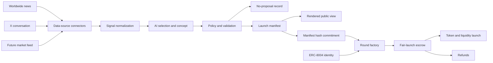

# Architecture

MemeToro separates idea generation from launch execution. The off-chain agent creates public proposals, while deterministic smart contracts enforce the published rules.

## Data sources

Dependency-free connectors collect current public signals for the agent. The initial connector queries Perplexity Sonar for broad worldwide-news coverage and xAI X Search for accelerating conversation on X. It returns structured candidates, evidence links, meme-relevance notes, and risk notes.

Connector responses are untrusted and may be incomplete, manipulated, or inaccurate. Later analysis must verify evidence, compare sources, preserve provenance, and reject unsafe or unsuitable topics. API providers and credentials are never part of the trusted launch path.

## Agent

The agent is the off-chain system that evaluates news, trends, culture, and market data, then creates meme-token proposals. The pipeline normalizes source records, asks the model to select and describe at most one candidate, and applies launch parameters from explicit policy. The model does not choose custody or execution rules and never controls contributor funds.

Two properties keep the agent honest about its own reasoning. It publishes every candidate it had available rather than only the winner, so a reader can assess the shortlist instead of accepting a conclusion. And it can decline: a window with nothing suitable produces a record explaining why, because a published shortlist means little if refusal is unreachable.

## Manifest

The launch manifest is the public, machine-readable record for a proposal. It contains the meme concept, the generated image and the prompt that produced it, market reasoning, risk assessment, cited evidence with its recorded context, countable source facts, the candidate selection record, token parameters, funding rules, launch conditions, and provenance. Once funding starts, its committed launch terms must not be silently changed.

The manifest stays canonical and machine-readable. Readable views are produced from it by a deterministic rendering function rather than written separately, so the page a contributor reads cannot state terms that differ from the ones the contracts would enforce.

Source facts are counts, never scores. Collection sources return no volume or engagement figures, so a strength rating would be invented, and invented precision is worse than none on a page where people decide to send funds.

## Smart contracts

Smart contracts are the deterministic system responsible for accepting funding, enforcing caps and deadlines, executing eligible launches, distributing token claims, and providing refunds when launch conditions are not met. These actions must remain available without the MemeToro backend.

The funding escrow is the first implemented piece. It holds one round's contributions and applies its published rules, with every launch parameter fixed as an immutable at construction so there is no owner, admin, or upgrade path able to change terms after funding opens. Native value can leave it only as a refund to the address that contributed it or as the whole raise handed to the launch executor, and the allocation split must assign the entire supply, so a round carrying an insider share cannot be constructed in the first place.

Contributors are not locked in the moment they commit. Withdrawals stay open until a published exit deadline, and finalization is barred until that deadline passes, so a round that fills its cap immediately still cannot launch early and cut the window short. After the deadline the round locks, which is what stops a large contributor from pulling out at the last second and collapsing a raise that others had already committed to.

Refunds open automatically when a round closes below its minimum, and again if finalization never happens within a grace period, so a broken executor cannot strand contributions. Leaving and launching are mutually exclusive throughout: finalization cannot happen while withdrawals are open, and it is barred again once refunds open.

One consequence is deliberate. Because withdrawing frees a wallet's room under the per-wallet cap, the cap limits what an address holds in a round at any moment rather than what it has ever sent, and a round's cumulative inflow can exceed its hard cap as people come and go. What the cap guarantees is the composition of the round at the moment it launches.

Token creation and liquidity provision sit behind an executor interface rather than inside the escrow. That boundary keeps the fairness properties testable without an exchange in the picture, and it is where the remaining launch work belongs.

## Manifest commitment

Every published document carries a digest of its own canonical form, and a launch round stores that digest on-chain as the manifest it was created for. The escrow never interprets it. It exists so anyone can check that the round was deployed against the exact proposal that was published, reasoning and rejected shortlist included, which is what turns "published terms cannot be silently changed" from a stated intention into something a reader can verify.

Canonicalization is the load-bearing part. Sorted keys, no insignificant whitespace, preserved array order, and integers only: each rule removes a way for two readers to hash the same document differently and reach opposite conclusions about whether it had been edited.

Verification happens off-chain, because a contract cannot parse a proposal. A reader canonicalizes the published document, hashes it, and compares with the committed value, then reads the round's immutables and compares them with the manifest's enforceable terms. The manifest publishes those terms twice for that reason: once as a person reads them and once as the integers the constructor takes, with validation rejecting any document where the two disagree.

The correspondence is tested rather than asserted. The contract suite loads the manifest the pipeline publishes and deploys a round from exactly those numbers, so a change to either half that breaks the mapping fails a test instead of surfacing at a deployment.

## Public interface

The public interface is the website or application through which users inspect proposals and manifests, contribute to funding rounds, finalize eligible launches, claim tokens, and request refunds. It is a convenience layer rather than a trusted part of execution.

The interface holds no rules of its own. Every action it offers is gated by an escrow view that answers whether that action is available now, and the most anyone can contribute is read from the contract rather than computed from the caps, so the page cannot disagree with the contract about timing or limits. It is built against the ABI published alongside the contracts and talks to the chain directly with no backend in the path. If the site is unavailable, the same calls can be made from a block explorer or the command line.

Rounds are created by a factory, not by hand. The factory asks the official ERC-8004 identity registry which wallet acts for an agent, deploys an escrow from the published terms, and stores the public URI of the manifest. A page lists rounds and declines by reading that factory. The image, reasoning, and rejected shortlist live in the published files, not on-chain.

## Principles

- The agent proposes.
- The contracts execute.
- The backend is optional.
- Launch conditions are public.
- There is no insider allocation.
- Published launch terms cannot be silently changed.
- A round commits to the manifest it was published under.
- Contributions are recoverable whenever a launch does not happen.
- The interface reads the rules from the contract instead of restating them.
- A listed round names the ERC-8004 agent that proposed it.
- Contributors can leave until the published exit deadline, and no launch happens before it.
- The rejected shortlist is published alongside the winner.
- Declining to propose is a valid outcome.
- Published figures are counted, not scored.
